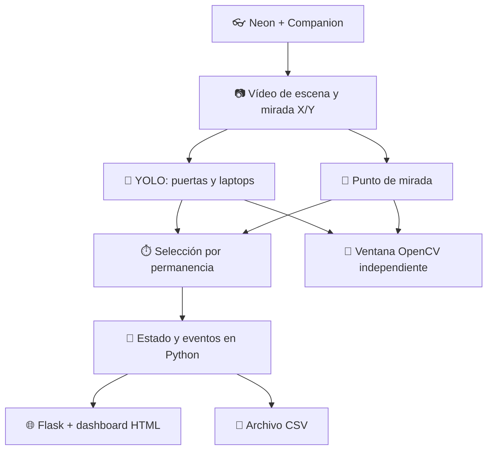

# 👁️🏠 Neon Smart Home — Eye Tracking + YOLO + Dashboard

> **Proyecto de visión artificial e interacción mediante la mirada.** Integra las gafas **Pupil Labs Neon**, dos detectores YOLO y un dashboard web para demostrar cómo sería controlar elementos de una casa inteligente con los ojos.


**Repositorio:** [Cesar313131/Proyecto-Imagen](https://github.com/Cesar313131/Proyecto-Imagen)

> [!IMPORTANT]
> **La puerta y la lámpara del dashboard son virtuales.** El programa todavía no acciona una puerta o una lámpara reales. La clasificación «puerta abierta/cerrada» es **aproximada** y debe validarse con los lentes.

## 📚 Índice

1. [¿Qué hace el proyecto?](#-qué-hace-el-proyecto)
2. [Requisitos](#-requisitos)
3. [Instalación desde cero en Windows](#-instalación-desde-cero-en-windows)
4. [Conectar los lentes Neon](#-conectar-los-lentes-neon)
5. [Iniciar el programa](#-iniciar-el-programa)
6. [Cómo utilizarlo](#-cómo-utilizarlo)
7. [Cómo funciona internamente](#-cómo-funciona-internamente)
8. [Archivos principales](#-archivos-principales)
9. [Comandos y configuración avanzada](#-comandos-y-configuración-avanzada)
10. [Solución de problemas](#-solución-de-problemas)
11. [Modelos, GitHub y limitaciones](#-modelos-github-y-limitaciones)

## ✨ ¿Qué hace el proyecto?

| Función | Descripción |
| --- | --- |
| 👓 **Eye tracking** | Recibe el vídeo de la cámara de escena y las coordenadas **X/Y** de la mirada de Neon. |
| 🚪 **Detección de puertas** | Un detector externo distingue aproximadamente las clases *door* y *doorway*. |
| 💻 **Detección de laptops** | Un modelo **YOLOv8n** preentrenado identifica laptops. |
| ⏱️ **Selección por mirada** | Al mantener la mirada sobre una detección durante **1,5 segundos**, se confirma una selección. |
| 🚪 **Puerta animada** | Cada selección confirmada de una puerta **alterna** la puerta virtual entre abierta y cerrada; la animación dura aproximadamente **2,5 segundos**. |
| 💡 **Lámpara virtual** | Mirar una zona **azul** permite encenderla; mirar una zona **roja**, apagarla, tras el tiempo de selección. |
| 📊 **Dashboard web** | Muestra conexión, X/Y, progreso, confirmaciones, detecciones, FPS, latencia y eventos. |
| 🎥 **Visualizador independiente** | El vídeo con cajas de YOLO y punto de mirada aparece en una ventana **OpenCV separada**; no se transmite al HTML. |
| 📝 **Registro de eventos** | Guarda las selecciones en `resultados/selecciones.csv`. |

## 🧰 Requisitos

- **Windows 10 u 11 de 64 bits**.
- **Python 3.11 o 3.12** instalado, preferiblemente con el lanzador `py`.
- **Git para Windows** si se desea clonar el repositorio desde PowerShell; también se puede descargar como ZIP.
- **Lentes Pupil Labs Neon** y teléfono con **Neon Companion** funcionando.
- Ordenador y teléfono/lentes en una **red con comunicación entre dispositivos**.
- Conexión a Internet para la **primera instalación** y para **descargar los pesos de los modelos**.
- Navegador moderno (Chrome, Edge, Firefox, etc.).
- **GPU opcional:** el procesamiento puede ejecutarse por CPU, aunque con dos modelos YOLO será más lento.

> [!NOTE]
> Este programa principal requiere **lentes Neon reales** para recibir imagen y mirada. No incorpora un modo de demostración con webcam.

## 🚀 Instalación desde cero en Windows

### Paso 1. Descargar el proyecto

**Opción A — Con Git (recomendada).**

Abre **PowerShell** y escribe:

```powershell
cd "$env:USERPROFILE"
git clone https://github.com/Cesar313131/Proyecto-Imagen.git
cd ".\Proyecto-Imagen"
dir
```

**Opción B — Sin Git.**

1. Abre el [repositorio en GitHub](https://github.com/Cesar313131/Proyecto-Imagen).
2. Pulsa **Code → Download ZIP**.
3. Descomprime el archivo.
4. Abre PowerShell en la carpeta descomprimida.
5. Comprueba que estás donde aparecen **`INSTALAR_WINDOWS.cmd`**, **`DESCARGAR_MODELOS.cmd`**, **`INICIAR_SISTEMA.cmd`** y **`neon_dashboard.py`**:

   ```powershell
   dir
   ```

**✅ Importante:** Los siguientes comandos se ejecutan desde **esa carpeta**, no desde su carpeta superior.

### Paso 2. Comprobar Python

En PowerShell:

```powershell
py --version
py -0p
```

Se necesita Python **3.11 o 3.12**. Si el comando `py` no existe, instala Python con su lanzador para Windows antes de continuar.

### Paso 3. Instalar las dependencias

```powershell
.\INSTALAR_WINDOWS.cmd
```

Este script:

1. Crea automáticamente **`.venv_neon`** dentro de la carpeta del proyecto.
2. Instala las librerías indicadas en **`requirements_yolo.txt`**.
3. Comprueba que las dependencias de Python no estén rotas.

Espera a que aparezca **`INSTALACION COMPLETADA`**. El primer proceso puede tardar varios minutos.

> **No hace falta descargar ni subir un `venv` a GitHub.** Cada persona genera el suyo con este mismo comando.

### Paso 4. Descargar los modelos de detección

```powershell
.\DESCARGAR_MODELOS.cmd
```

El script descarga automáticamente los modelos preentrenados a **`modelos/`**. Verifica su presencia:

```powershell
dir .\modelos
```

Deberían aparecer:

| Modelo | Archivo | Función |
| --- | --- | --- |
| 💻 **Ultralytics YOLOv8n** | `modelos/yolov8n.pt` | Detectar laptops mediante la clase *laptop* del conjunto COCO. |
| 🚪 **Detector externo de puertas** | `modelos/doorway_seg_yolo26n.pt` | Distinguir *door* y *doorway*; se interpretan aproximadamente como cerrada y abierta. |

El modelo de puertas se obtiene del repositorio de modelos **`perseusdg/doorway-door-people-window-seg`** mediante `huggingface_hub`. **Ninguno de estos dos modelos fue entrenado desde cero por este proyecto**.

> [!TIP]
> **Solo se instalan dependencias y se descargan pesos la primera vez**, salvo que cambies de ordenador, borres el entorno o actualices las versiones.

## 📶 Conectar los lentes Neon

1. Enciende los **Pupil Labs Neon**.
2. Comprueba que estén conectados al teléfono con **Neon Companion**.
3. Conecta el PC a una red desde la cual pueda comunicarse con el teléfono.
4. Ponte los lentes para que se reciban datos válidos de mirada.
5. Cierra otros programas que estén utilizando el flujo de Neon; evita ejecutar **`neon_domotica.py`**, **`visualizar_gaze.py`** y el dashboard a la vez.
6. Si quieres comprobar primero la conexión desde PowerShell:

   ```powershell
   .\.venv_neon\Scripts\python.exe prueba_gaze.py
   ```

   La prueba debe encontrar los lentes. **No necesitas introducir manualmente una IP:** el programa intenta descubrir el dispositivo automáticamente.

**Si no encuentra los lentes**, revisa Neon Companion, la conexión de red y que ningún otro proceso esté ocupando el flujo.

## ▶️ Iniciar el programa

### Paso 5. Arrancar YOLO, Neon y el dashboard

Desde la carpeta donde están los archivos `.cmd`, ejecuta:

```powershell
.\INICIAR_SISTEMA.cmd --imgsz 320
```

El programa:

1. Verifica que exista el entorno Python y que estén descargados ambos modelos.
2. Carga los dos detectores YOLO.
3. Inicia el servidor web **Flask**.
4. Intenta abrir automáticamente el dashboard en el navegador.
5. Busca los lentes Neon y comienza a procesar vídeo y mirada cuando estén disponibles.
6. Abre una **ventana de OpenCV aparte** con el vídeo, las cajas de detección y el punto de mirada.

### Paso 6. Abrir el dashboard

Si no se abre automáticamente, entra desde el navegador a:

**🌐 http://127.0.0.1:5000**

Verás el estado de conexión, las coordenadas de mirada y la puerta virtual animada. **No esperes vídeo dentro del HTML**: es intencional y ayuda a reducir el trabajo de transmisión.

### Paso 7. Detenerlo correctamente

- Pulsa **`Q`** o **`ESC`** dentro de la ventana OpenCV.
- También puedes utilizar **`Ctrl + C`** en PowerShell.
- No es necesario eliminar el entorno virtual ni volver a instalar nada para la próxima ejecución.

### 🔁 Para las siguientes sesiones

Solo tendrás que:

1. Conectar teléfono y lentes Neon.
2. Abrir PowerShell dentro del proyecto.
3. Ejecutar:

   ```powershell
   .\INICIAR_SISTEMA.cmd --imgsz 320
   ```

4. Abrir **http://127.0.0.1:5000** si no aparece automáticamente.

## 🎮 Cómo utilizarlo

### 🚪 Puerta virtual

1. Mira una puerta real que aparezca dentro de la cámara de escena.
2. YOLO intenta detectarla y dibuja su caja en OpenCV.
3. Coloca la mirada dentro de la caja de detección.
4. Mantén la mirada aproximadamente **1,5 segundos**: el anillo y la barra del dashboard muestran el progreso.
5. Al confirmarse, la **puerta del dashboard** empieza a abrirse o cerrarse progresivamente.
6. Aparta la mirada al menos **0,3 segundos** antes de volver a seleccionarla.

**Diferencia importante:** el estado estimado por YOLO (*abierta/cerrada*) se muestra como **información de visión**, mientras que cada selección por mirada **alterna el estado virtual**. **No se abre ni se cierra una puerta física.**

### 💻 Laptop

Mira una laptop detectada durante **1,5 segundos**. Se registrará la selección y aparecerá una confirmación en el dashboard; **no se ejecuta ninguna acción sobre la laptop real**.

### 💡 Lámpara virtual

- Mira una zona **azul** durante el tiempo de selección para **encender** la lámpara virtual.
- Mira una zona **roja** para **apagarla**.

La detección de color depende de la iluminación y de que la mirada caiga sobre una región de color suficiente.

## 🧠 Cómo funciona internamente



**Resumen paso a paso:**

1. El SDK de Neon entrega un fotograma de escena y la mirada correspondiente.
2. **`neon_dashboard.py`** pasa el fotograma por los dos modelos YOLO.
3. **`vision_core.py`** comprueba si el punto X/Y está dentro de una caja detectada y acumula el tiempo de fijación.
4. Cuando supera el tiempo configurado, se confirma **una sola** selección hasta que se retire la mirada el tiempo necesario.
5. Python actualiza el estado de puerta/lámpara virtual, registra eventos y expone el estado mediante una API local.
6. **`templates/index.html`** consulta ese estado para actualizar la interfaz y ejecutar la animación de la puerta.
7. **OpenCV** muestra el vídeo procesado en una ventana separada.

## 🗂️ Archivos principales

```text
Proyecto-Imagen/
├── README.md                      # 📖 Esta guía
├── INSTALAR_WINDOWS.cmd           # 🛠️ Instala librerías en .venv_neon
├── DESCARGAR_MODELOS.cmd          # ⬇️ Descarga los pesos de YOLO
├── INICIAR_SISTEMA.cmd            # ▶️ Inicia la aplicación
├── requirements.txt               # Dependencias generales
├── requirements_yolo.txt          # Dependencias usadas por el instalador
├── descargar_modelos.py           # Descarga y verifica ambos modelos
├── neon_dashboard.py              # 👓 Neon + YOLO + Flask + OpenCV
├── vision_core.py                 # 🎯 Detección de mirada y permanencia
├── prueba_gaze.py                 # 🧪 Prueba básica de conexión
├── visualizar_gaze.py             # Visualizador de mirada independiente
├── neon_control.py                # Prueba anterior de control por colores
├── neon_monitor.py                # Utilidad de monitorización
├── neon_domotica.py               # Versión anterior conservada
├── templates/
│   ├── index.html                 # 🖥️ Dashboard actual sin vídeo
│   └── index_original.html        # Interfaz anterior
├── modelos/                       # Pesos descargados (.pt), no se suben a Git
└── resultados/                    # selecciones.csv y otros resultados locales
```

### 📡 Rutas de la aplicación

| Ruta | Función |
| --- | --- |
| `/` | Dashboard web. |
| `/api/state` | Estado JSON para coordenadas, detecciones, selección, eventos y acciones virtuales. |
| `/api/health` | Respuesta simple para comprobar servidor y conexión Neon. |

Por defecto Flask escucha en **`127.0.0.1`**, es decir, **solo en el PC donde se ejecuta**.

## ⚙️ Comandos y configuración avanzada

Si necesitas ajustar el rendimiento, puedes iniciar directamente Python:

```powershell
.\.venv_neon\Scripts\python.exe neon_dashboard.py --imgsz 320
```

| Opción | Ejemplo | Para qué sirve |
| --- | --- | --- |
| `--imgsz` | `--imgsz 256` | Baja la resolución usada por YOLO: normalmente más rápido, pero puede perder detecciones. |
| `--dwell` | `--dwell 2.0` | Exige 2 segundos de mirada para confirmar una acción. |
| `--conf` | `--conf 0.50` | Aumenta el umbral de confianza para aceptar detecciones. |
| `--port` | `--port 5050` | Usa otro puerto si 5000 está ocupado. |
| `--no-browser` | `--no-browser` | No abre el navegador automáticamente. |
| `--no-window` | `--no-window` | Oculta la ventana de OpenCV (opción avanzada). |
| `--door-weights` | `--door-weights "modelos\mi_puerta.pt"` | Usa otro modelo de puertas compatible con las clases esperadas. |
| `--laptop-weights` | `--laptop-weights "modelos\mi_laptop.pt"` | Usa otro modelo con clase `laptop`. |

Ejemplo con resolución menor y otro puerto:

```powershell
.\INICIAR_SISTEMA.cmd --imgsz 256 --port 5050
```

Después abre **http://127.0.0.1:5050**.

Para comprobar si PyTorch detecta CUDA:

```powershell
.\.venv_neon\Scripts\python.exe -c "import torch; print(torch.cuda.is_available())"
```

Si aparece `False`, no significa necesariamente que el programa esté roto; podría estar utilizando CPU.

## 🧯 Solución de problemas

<details>
<summary>❌ «No se encontraron los lentes»</summary>

- Comprueba que **Neon Companion** esté activo y vinculado a los lentes.
- Revisa la conexión entre teléfono y ordenador.
- Cierra otras aplicaciones que estén leyendo el flujo de Neon.
- Ejecuta `prueba_gaze.py` para comprobar la detección del dispositivo.
- El programa principal reintenta conectarse cuando no encuentra Neon.

</details>

<details>
<summary>❌ «Faltan modelos YOLO»</summary>

Desde la carpeta correcta:

```powershell
.\DESCARGAR_MODELOS.cmd
```

Necesitas Internet durante la descarga. Comprueba después que existan los dos archivos `.pt` en `modelos/`.

</details>

<details>
<summary>🐢 La ventana OpenCV va lenta o con retraso</summary>

- Prueba `--imgsz 256`.
- Cierra otras aplicaciones pesadas o que estén utilizando Neon.
- Comprueba la calidad de conexión con el teléfono.
- Revisa si PyTorch utiliza GPU/CUDA. El código ejecuta **dos inferencias YOLO por fotograma**, por lo que CPU puede ser lenta.
- Evita tener abierto `visualizar_gaze.py` a la vez que el programa principal.

</details>

<details>
<summary>🛑 La ventana se cierra al empezar a detectar objetos</summary>

Esta versión corregida sustituye referencias antiguas `obj.conf` por `obj.confidence`. Si el problema reaparece, ejecuta el script desde PowerShell para ver el error completo:

```powershell
.\.venv_neon\Scripts\python.exe neon_dashboard.py --imgsz 320
```

Copia el **Traceback completo** que aparezca en la consola. La aplicación incluye un intento de reconexión tras errores de procesamiento, pero hay que revisar la causa real.

</details>

<details>
<summary>🌐 El puerto 5000 está ocupado</summary>

```powershell
.\INICIAR_SISTEMA.cmd --port 5050
```

Abre luego http://127.0.0.1:5050 y cierra cualquier instancia anterior de Flask.

</details>

<details>
<summary>🖥️ No aparece vídeo dentro del HTML</summary>

**Es el comportamiento esperado.** La imagen se presenta en una ventana independiente de **OpenCV**; el HTML recibe únicamente estados y coordenadas mediante JSON.

</details>

<details>
<summary>📦 «requirements.txt no existe» o PowerShell no encuentra un .cmd</summary>

Seguramente estás **una carpeta por encima**. Ejecuta:

```powershell
dir
```

Debes estar en la misma carpeta que `neon_dashboard.py` y los tres scripts `.cmd`. Si todavía ves una subcarpeta que contiene todo el proyecto, entra en ella con `cd .\NOMBRE_DE_LA_CARPETA`.

</details>

## 📦 Modelos, GitHub y limitaciones

### ¿Por qué no se suben `.venv_neon` ni los pesos `.pt`?

- Cada ordenador tiene su propia instalación y entorno. Compartir un `venv` de Windows suele causar problemas de rutas y compatibilidad.
- Los pesos pueden ocupar bastante espacio y se obtienen con **`DESCARGAR_MODELOS.cmd`**.
- **GitHub contiene el código y los scripts de instalación**; los archivos generados se recrean localmente.
- Si más adelante entrenamos un modelo propio, podremos distribuir sus pesos mediante un sistema de descarga o Git LFS, teniendo en cuenta tamaño y licencias.

### ⚠️ Limitaciones actuales

1. El detector de puertas **no es un clasificador específicamente entrenado y validado** para puertas abiertas/cerradas del entorno de pruebas: se interpreta *doorway ≈ abierta* y *door ≈ cerrada*, lo que puede fallar.
2. La puerta del dashboard **alterna de estado con la mirada**; no sigue físicamente el estado detectado.
3. **No hay actuadores ni control de puertas o lámparas reales.**
4. No existe un modo de prueba del dashboard completo sin los lentes reales.
5. La velocidad depende de la red, del ordenador y de los modelos YOLO.
6. Las pruebas de funcionamiento con gafas físicas y distintos entornos deben documentarse por separado; **no se garantizan resultados de precisión**.

### 🔐 Privacidad

El vídeo se procesa y visualiza localmente en OpenCV; **no se transmite como vídeo al dashboard**. La API local sí entrega coordenadas X/Y y estados de detección, y las selecciones quedan registradas en **`resultados/selecciones.csv`**. Evita compartir registros que puedan contener información sensible.

### 📜 Modelos de terceros y licencias

El detector de laptops procede de **Ultralytics YOLOv8n/COCO** y el de puertas de **`perseusdg/doorway-door-people-window-seg`**. Sus pesos pertenecen a sus respectivos autores y están sujetos a sus licencias; el código del descargador identifica **AGPL-3.0** para el modelo externo de puertas. Revisa las condiciones aplicables antes de redistribuir pesos o utilizar el sistema comercialmente.

---

### 💙 Próximos pasos propuestos

- [ ] Crear un dataset propio de **puertas abiertas y cerradas** y entrenar un detector adecuado.
- [ ] Evaluar la precisión, falsas detecciones y latencia en diferentes condiciones.
- [ ] Mejorar el seguimiento temporal de la mirada y de las detecciones.
- [ ] Añadir pruebas reproducibles y documentación de resultados.
- [ ] Integrar actuadores reales **solo después** de validar el sistema de seguridad.

**Hecho para aprender, experimentar y avanzar hacia una domótica controlada con la mirada.** 👁️🚪✨
